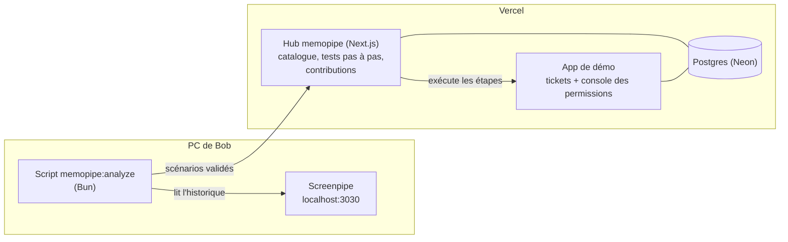

<!-- screenpipe — AI that knows everything you've seen, said, or heard -->
<!-- https://screenpipe.com -->
# memopipe — MVP en 12 h

> Une équipe partage ses automatisations. Avant d'en réutiliser une, chacun la teste sur les cas réels de son propre historique Screenpipe, voit le résultat de chaque étape, la corrige et propose sa correction. Le propriétaire approuve, et la nouvelle version profite à tout le monde.

*memopipe is a collaborative automation platform powered by Screenpipe. Teams share workflows, test them against their own work history, discover overlooked edge cases, and contribute improvements back to the team.*

Ce document ne garde que le strict nécessaire pour la démo du MVP. La version complète est sauvegardée hors du repo.

## 1. Ce que la démo doit montrer

1. **Alice publie** son automatisation « Attribuer les accès d'un nouvel arrivant » (v1), testée sur un cas CDI.
2. **Bob veut la réutiliser.** Il lance le script d'analyse sur son PC.
3. **Screenpipe fournit un cas réel.** Le script retrouve dans l'historique de Bob un ticket de prestataire traité avec des accès limités. Bob valide ce comportement, et le cas devient un scénario de test.
4. **Bob teste la v1 pas à pas.** Chaque étape s'exécute sur l'app de démo, avec son résultat affiché.
5. **L'anomalie apparaît.** La v1 donne le VPN de production et GitHub en écriture à un prestataire, sans expiration.
6. **Bob corrige une copie**, relance tous les tests : tout passe, y compris le cas d'Alice.
7. **Bob propose sa correction** avec ses résultats de tests.
8. **Alice approuve** : la v2 est publiée.

## 2. Ce qu'on ne fait pas

- **Pas de sandbox.** Les tests s'exécutent pour de vrai sur l'app de démo. Chaque test travaille sur une copie fraîche du ticket, donc les tests ne se marchent pas dessus. Avec de vrais systèmes, il faudra une sandbox ; ici, l'app de démo joue ce rôle.
- **Pas d'agent local avec interface.** Côté PC, seulement un script en terminal. Tout le reste est dans le hub web.
- **Pas d'IA obligatoire.** L'app de démo affiche un texte qu'on contrôle, donc de simples expressions régulières suffisent à la lire. L'IA est un bonus (section 12).
- **Pas de vraie authentification.** On choisit « Je suis Alice » ou « Je suis Bob ». Alice est propriétaire de l'automatisation.
- **Pas de messagerie.** Les échanges entre collègues sont des commentaires sur le ticket.
- **Pas de synchro hors ligne, d'anonymisation, de rôles, de rebase, de fusion de doublons, ni de vraie intégration.** Toutes les données sont fictives.

## 3. Architecture



| Composant | Où | Rôle |
|---|---|---|
| **Hub memopipe** | Vercel : Next.js + Postgres Neon | Catalogue, publication, scénarios, test pas à pas, copie de travail, contribution, approbation |
| **App de démo « Nimbus IT »** | Même projet Next.js, sous `/demo` | Tickets et console des permissions. Les automatisations agissent dessus, et Screenpipe la capture quand Bob l'utilise. |
| **Script `memopipe:analyze`** | PC de chaque membre, Bun | Lit Screenpipe en local, reconstruit les cas, demande la validation, envoie les scénarios validés |

Les captures Screenpipe ne quittent jamais le PC. Le script n'envoie que les scénarios validés par Bob : champs du ticket, accès attendus, et quelques citations avec leur ID de frame.

Dépôt `memopipe-serv` (le hub, l'app de démo et le moteur) :

```
memopipe-serv/
├── app/
│   ├── (hub)/                          # le hub memopipe
│   │   ├── page.tsx                    # catalogue
│   │   ├── a/new/page.tsx              # publier une automatisation
│   │   ├── a/[slug]/page.tsx           # fiche : DSL, scénarios, « Tout tester », contributions, versions
│   │   ├── d/[id]/page.tsx             # copie de travail : éditeur, « Tout tester », diff, « Proposer »
│   │   ├── c/[id]/page.tsx             # contribution : diff, résultats, discussion, décision
│   │   ├── runs/[id]/page.tsx          # test pas à pas
│   │   ├── contributions/page.tsx      # toutes les contributions
│   │   ├── equipe/page.tsx             # membres, branchement Screenpipe, réinitialisation de la démo
│   │   ├── layout.tsx                  # barre du haut, « Je suis Alice / Bob / Chloé »
│   │   └── actions.ts                  # server actions du hub
│   ├── demo/                           # app de démo « Nimbus IT » : tickets et console des permissions
│   ├── api/scenarios/route.ts          # GET : automatisations ; POST : scénario envoyé par le script
│   └── api/demo/reset/route.ts         # remise à zéro de la démo
├── components/                         # affichage du DSL, diff, tableaux, formulaires
├── lib/
│   ├── types.ts                        # contrats (actions, état d'un test, format d'un scénario)
│   ├── dsl.ts                          # parser, expressions, compilation en instructions
│   ├── runner.ts                       # exécution pas à pas, comparaison attendu/obtenu
│   ├── labels.ts                       # libellés affichés par la console (lus par le script)
│   ├── data.ts                         # toutes les opérations : catalogue, tests, contributions, démo
│   ├── db.ts, schema.ts                # Postgres : Neon en production, PGlite en local
│   └── seed.ts                         # données de départ (v1 d'Alice, tickets)
└── tests/                              # bun test : moteur + parcours complet sur Postgres en mémoire
```

Le script `memopipe:analyze` n'est pas dans ce dépôt : il tourne sur le PC qui a l'historique Screenpipe, et ne parle au hub que par `POST /api/scenarios`.

### Stack

| Partie | Technos |
|---|---|
| Langage | TypeScript partout |
| Hub et app de démo | Next.js 16 (App Router, server actions) + React 19 ; CSS maison (`app/globals.css`) aux couleurs de screenpipe.com ; polices IBM Plex Sans, IBM Plex Mono et Crimson Text |
| Base de données | Postgres Neon en production, ajoutée depuis le Marketplace Vercel (qui pose `DATABASE_URL`), avec le pilote `@neondatabase/serverless`. Sans `DATABASE_URL`, PGlite (Postgres embarqué) dans `.data/pglite`. Même SQL, écrit à la main dans `lib/schema.ts`, sans ORM. |
| Moteur (DSL, runner) | TypeScript pur dans `lib/`, sans aucun import de Next.js : il se teste seul avec `bun test` |
| Diff des contributions | Paquet npm `diff` |
| Hébergement | Vercel, racine du dépôt `memopipe-serv` |
| Script local | Bun 1.3 ou plus (comme le starter), sans dépendance ; Bun charge `.env` tout seul |
| Screenpipe | API REST locale `http://localhost:3030`, clé `SCREENPIPE_LOCAL_API_KEY` |
| Paquets et tests | Bun partout (`bun install`, `bun test`) ; Vercel détecte Bun grâce à `bun.lock` |
| IA | Aucune dans le MVP. Les bonus réutilisent l'adaptateur compatible OpenAI du starter (`AI_BASE_URL`, `AI_MODEL`, `AI_API_KEY`). |

Variables d'environnement :
- **Hub** (Vercel) : `DATABASE_URL`, `MEMOPIPE_TEAM_TOKEN`.
- **Script** (`.env` à la racine) : `SCREENPIPE_LOCAL_API_KEY`, `MEMOPIPE_HUB_URL`, `MEMOPIPE_TEAM_TOKEN`.

### Dépôt et répartition

**Deux dépôts.** `memopipe-serv` contient le hub, l'app de démo et le moteur (le moteur est déjà écrit et testé). Le script `memopipe:analyze` vit à part, sur le PC qui a l'historique Screenpipe. Les deux ne partagent qu'un contrat : le format d'un scénario envoyé à `POST /api/scenarios` (section 6, type `ScenarioInput` dans `lib/types.ts`).

| Personne | Partie | Où |
|---|---|---|
| A | Script Screenpipe | Script `memopipe:analyze` et ses fixtures, mise en scène de l'historique (bloc 3) |
| B | Site | `memopipe-serv` : `app/`, `components/`, `lib/` |

Deux choses ne doivent plus changer une fois figées, parce que le script les lit avec des expressions régulières :
1. le format d'un scénario (section 6) ;
2. le texte exact des pages de démo (section 4), défini dans `lib/labels.ts` et `app/demo/`.

## 4. L'app de démo

Deux pages, plus des données de départ.

**Tickets** (`/demo/tickets/T-1182`)
- Champs : type, statut, demandeur (nom, email, type de contrat, équipe, fin de mission) et commentaires.
- Boutons : « Approuver », « Commenter », « Terminer ».
- Titre de la page : `T-1182 · Tickets Nimbus`. Screenpipe le récupère dans `window_name`, ce qui permet de découper l'historique ticket par ticket.

**Console des permissions** (`/demo/console/<email>`)
- Un sélecteur par système, une date d'expiration et un bouton « Enregistrer ».
- Après l'enregistrement, un résumé en texte simple :
  ```
  Modifications enregistrées le 18/10/2026 à 09:24
  GitHub : Lecture seule
  VPN production : Non
  Slack : Invité
  Expiration : 15/01/2027
  ```
- Titre de la page : `Console des permissions · <email>`.

Pour que Screenpipe lise bien ces pages : du vrai texte HTML (ni image ni canvas), des libellés stables de la forme « Système : Niveau », et l'email du demandeur visible sur le ticket et dans la console.

**Données de départ** (`/demo/reset`)

| Ticket | Demandeur (fictif) | Contrat | Rôle dans la démo |
|---|---|---|---|
| T-1175 | Hugo Petit | CDI, support | Cas de Bob, conforme à la v1 |
| T-1182 | Inès Fabre | Prestataire, data, fin le 15/01/2027 | Cas de Bob qui révèle l'anomalie |
| T-1201 | Nora Diallo | Prestataire, design | Bonus : exécution réelle de la v2 |

## 5. Le format des automatisations

```
AUTOMATION "Attribuer les accès d'un nouvel arrivant"
USAGE "Demandes d'accès approuvées. Attribue le profil standard."

SET p = ticket.requester
DO iam.grant user=p.email system="github" level="write"
DO iam.grant user=p.email system="vpn-prod" level="access"
DO iam.grant user=p.email system="slack" level="member"
DO tickets.comment id=ticket.id text="Accès standards attribués."
DO tickets.close id=ticket.id
```

- **Trois instructions** : `SET`, `DO`, et `IF … ELSE … END`.
- **`ticket`** est le ticket du test.
- **Trois actions** : `iam.grant(user, system, level, expires?)`, `tickets.comment(id, text)`, `tickets.close(id)`. Une action inconnue est une erreur avant toute exécution.
- **Systèmes et niveaux** : `github` (`none`, `read`, `write`), `vpn-prod` (`none`, `access`), `slack` (`none`, `guest`, `member`). `expires` est une date facultative.
- **Expressions** : chemins (`p.email`), chaînes, `==`, `!=`, `not`, `and`, `or`, interpolation `{{p.name}}`. Pas d'`eval`.
- **Compilation** : le texte est compilé en une liste d'instructions numérotées, avec des sauts pour `IF` et `ELSE`. L'état d'un test tient alors en `{pc, vars}`, et le pas à pas consiste à exécuter l'instruction `pc` puis à enregistrer le nouvel état.

## 6. Les scénarios

Un scénario, c'est un ticket d'entrée et les accès attendus à la fin.

```json
{
  "title": "Prestataire externe, mission de 3 mois",
  "origin": "Screenpipe · Bob · T-1182",
  "ticket": {
    "type": "access_request",
    "requester": { "name": "Inès Fabre", "email": "ines.fabre@presta.example",
                   "contract": "prestataire", "team": "data", "end_date": "2027-01-15" }
  },
  "expected": {
    "github": "read", "vpn-prod": "none", "slack": "guest",
    "expires_before": "2027-01-15", "ticket_status": "done"
  },
  "evidence": [
    { "frame_id": 51234, "quote": "GitHub : Lecture seule" },
    { "frame_id": 51234, "quote": "VPN production : Non" },
    { "frame_id": 51190, "quote": "Mission de 3 mois en prestation : GitHub en lecture seule, pas de VPN prod" }
  ]
}
```

- **Deux origines.** Le scénario CDI d'Alice est écrit à la main dans le hub (JSON dans un champ texte). Ceux de Bob viennent du script.
- **Comparaison.** Pour chaque système, l'accès obtenu doit égaler l'accès attendu, `none` voulant dire « aucun accès ». Avec `expires_before`, tous les accès du demandeur doivent expirer au plus tard à cette date. `ticket_status` est le statut final du ticket.
- **Validation.** Le script ne pose la question qu'une fois par cas, et un cas refusé n'est jamais envoyé : le passé ne devient une référence que si Bob le confirme.

## 7. Le script local d'analyse Screenpipe

```
$ bun run memopipe:analyze --hub https://memopipe-xxx.vercel.app --automation attribuer-acces
memopipe va lire ton historique Screenpipe, sur ce PC uniquement :
  période  : 24 dernières heures
  fenêtres : « Tickets Nimbus », « Console des permissions »
Rien n'est envoyé sans ta confirmation. Continuer ? (o/n) o

2 demandes d'accès retrouvées

T-1182 · Inès Fabre · prestataire · fin le 15/01/2027
  Accès enregistrés le 18/10 à 09:24 (screenpipe://frame/51234) :
    GitHub : Lecture seule · VPN production : Non · Slack : Invité · Expiration : 15/01/2027
  Commentaire du ticket : « Mission de 3 mois en prestation : GitHub en lecture seule, pas de VPN prod »
  Ce comportement est-il le bon ? (o = valider, n = rejeter) o

T-1175 · Hugo Petit · CDI · support
  Accès enregistrés le 18/10 à 09:05 (screenpipe://frame/51102) :
    GitHub : Écriture · VPN production : Oui · Slack : Membre
  Ce comportement est-il le bon ? (o/n) o

2 scénarios envoyés au hub.
```

**Comment il fonctionne**
1. Il affiche le périmètre et attend un « o ». Rien n'est lu avant.
2. Il interroge `GET /search?content_type=accessibility&window_name=Tickets%20Nimbus&start_time=24h%20ago&limit=20&offset=…` en paginant (offset incrémenté, arrêt sur page vide). Si le résultat est vide, il réessaie avec `content_type=ocr`.
3. Il regroupe les résultats par n° de ticket, lu dans `window_name`, et lit les champs du ticket avec des expressions régulières (« Type de contrat : … », « Fin de mission : … », email, commentaires).
4. Il fait la même chose pour la fenêtre `Console des permissions · <email>`. Pour chaque email, il garde la dernière frame qui contient « Modifications enregistrées », puis lit les lignes « Système : Niveau » et « Expiration : … ».
5. Il affiche chaque cas avec ses citations et ses liens `screenpipe://frame/<id>`, puis demande la validation.
6. Il envoie les cas validés à `POST /api/scenarios`, avec le jeton d'équipe `MEMOPIPE_TEAM_TOKEN`.

**Options**
- `--since 24h` : période d'analyse.
- `--save fixtures/bob.json` : enregistre les réponses Screenpipe.
- `--fixtures fixtures/bob.json` : rejoue des réponses enregistrées, en secours si la capture ne marche pas le jour J.

Le script réutilise les garde-fous de `fetchLocalRecords` dans `src/core.ts` (adresse locale uniquement, authentification, timeout) et y ajoute la pagination.

## 8. Le test pas à pas

Sur la fiche de l'automatisation, chaque scénario a un bouton « Tester pas à pas ».

1. Le hub crée dans l'app de démo une copie fraîche du ticket du scénario (`T-1182-R7` pour le test n° 7), avec un email dédié (`ines.fabre+r7@presta.example`). Les tests ne se mélangent donc pas.
2. Chaque clic sur « Étape suivante » exécute une instruction sur l'app de démo et affiche son résultat. « Tout exécuter » va jusqu'au bout.
3. À la fin, le hub lit les accès du demandeur dans la console et les compare aux attendus.

```
Test pas à pas · v1 · « Prestataire externe, mission de 3 mois »
Ticket de test T-1182-R7 · Inès Fabre (prestataire, fin le 15/01/2027)

 ✓ 1  SET p = ticket.requester                 p = Inès Fabre · prestataire · data
 ✓ 2  DO iam.grant … github write              accès créé : GitHub = Écriture
 ✓ 3  DO iam.grant … vpn-prod access           accès créé : VPN production = Oui
 ▶ 4  DO iam.grant … slack member              [ Étape suivante ]  [ Tout exécuter ]
   5  DO tickets.comment …
   6  DO tickets.close …

Résultat
  GitHub           attendu : lecture             obtenu : écriture   ✗
  VPN production   attendu : aucun               obtenu : oui        ✗
  Slack            attendu : invité              obtenu : membre     ✗
  Expiration       attendu : ≤ 15/01/2027        obtenu : aucune     ✗
  Ticket           attendu : terminé             obtenu : terminé    ✓
  [ Voir dans la console des permissions ]
```

Le bouton « Voir dans la console » ouvre la vraie page de la console pour le demandeur du test. Les effets sont visibles pour de vrai.

## 9. Contributions et versions

1. Sur la fiche, **« Modifier une copie »** ouvre un éditeur (un champ texte) prérempli avec la version courante.
2. **« Tout tester »** exécute tous les scénarios sur la copie, d'un coup, et affiche le tableau v1 contre copie.
3. **« Proposer »** demande une raison, puis crée la contribution.
4. La page de la contribution montre le diff ligne par ligne (paquet npm `diff`), la raison, le tableau des résultats et les commentaires.
5. **« Approuver »** n'apparaît que pour Alice. Le bouton reste grisé tant qu'un scénario échoue sur la copie. L'approbation crée la v2 et en fait la version courante.

La copie de Bob :

```
SET p = ticket.requester
IF p.contract == "prestataire"
  DO iam.grant user=p.email system="github" level="read" expires=p.end_date
  DO iam.grant user=p.email system="slack" level="guest" expires=p.end_date
ELSE
  DO iam.grant user=p.email system="github" level="write"
  DO iam.grant user=p.email system="vpn-prod" level="access"
  DO iam.grant user=p.email system="slack" level="member"
END
DO tickets.comment id=ticket.id text="Accès attribués ({{p.contract}})."
DO tickets.close id=ticket.id
```

```
Tests                                v1       copie de Bob
CDI développement (Alice)            ✓        ✓
T-1175 · CDI support (Bob)           ✓        ✓
T-1182 · Prestataire, 3 mois (Bob)   ✗ 4      ✓
                                     2/3      3/3
```

## 10. Données

| Table | Colonnes |
|---|---|
| `automations` | `id`, `title`, `usage`, `owner`, `current_version` |
| `versions` | `id`, `automation_id`, `number`, `dsl`, `author`, `created_at` |
| `scenarios` | `id`, `automation_id`, `title`, `origin`, `ticket` (jsonb), `expected` (jsonb), `evidence` (jsonb) |
| `drafts` | `id`, `automation_id`, `base_version`, `author`, `dsl`, `reason`, `status` (`draft`, `proposed`, `approved`) |
| `comments` | `id`, `draft_id`, `author`, `body`, `created_at` |
| `runs` | `id`, `dsl`, `scenario_id`, `test_ticket`, `pc`, `vars` (jsonb), `steps` (jsonb), `status`, `result` (jsonb) |
| `tickets` | `id`, `type`, `status`, `requester` (jsonb), `comments` (jsonb) |
| `grants` | `email`, `system`, `level`, `expires` |

Une contribution est simplement un `draft` dont le statut est `proposed`.

| Route | Rôle |
|---|---|
| `GET /api/scenarios` | Liste les automatisations (slug, titre, version) : le script vérifie que la sienne existe |
| `POST /api/scenarios` | Reçoit un scénario validé du script (jeton d'équipe si `MEMOPIPE_TEAM_TOKEN` est défini) |
| `POST /api/demo/reset` | `{"scope": "demo"}` remet tickets et accès à zéro ; `{"scope": "all"}` repart du catalogue avec la v1 d'Alice |

Tout le reste (tests pas à pas, « Tout tester », publier, modifier, proposer, commenter, approuver, formulaires de l'app de démo) passe par des server actions Next.js (`app/(hub)/actions.ts`, `app/demo/actions.ts`).

## 11. Plan de 12 h

| # | Bloc | Durée | Qui | État |
|---|---|---|---|---|
| 1 | Projet Next.js, Neon, « Je suis Alice / Bob », déploiement Vercel | 1 h | B | Fait, sauf le déploiement |
| 2 | App de démo : tickets, console, données de départ, reset | 2 h | B | Fait |
| 3 | Relancer Screenpipe, vérifier la capture, puis Bob traite T-1175 et T-1182 dans l'app (avec `--save`) | 45 min | A, dès la fin du bloc 2 | À faire |
| 4 | DSL : parser, expressions, compilation en instructions | 1 h 30 | A | Fait (dans `memopipe-serv`) |
| 5 | Test pas à pas : runner et comparaison (A), page de test (B) | 2 h | A et B | Fait |
| 6 | Catalogue, fiche, publication, scénario écrit à la main | 1 h | B | Fait |
| 7 | Script `memopipe:analyze` | 2 h | A | À faire |
| 8 | Copie de travail, « Tout tester », contribution, diff, approbation, v2 | 1 h 30 | B (pages), A (« Tout tester ») | Fait |
| 9 | Répétition de la démo, vidéo de secours | 45 min | A et B | À faire |

A = moteur et Screenpipe, B = site (section 3). Environ 12 h 30 de travail, soit 6 à 7 h de temps réel à deux. Seul, c'est juste : sacrifier d'abord le bloc 6 (versions et scénario d'Alice créés par un script de données de départ).

**Deux rendez-vous**
- **Vers H+3 : B déploie l'app de démo**, même sans style. C'est la dépendance critique : sans elle, A ne peut ni enregistrer l'historique de Bob (bloc 3) ni tester son script sur de vraies captures. En attendant, A code le moteur.
- **Vers H+6 : intégration.** B branche le runner dans la page de test, et le script de A envoie ses scénarios au hub déployé. Ensuite, répétition de la démo à deux.

> **Règle.** On ne touche à aucun bonus tant que les 8 étapes de la section 1 ne tournent pas de bout en bout.

**Tests indispensables** (`bun test`)
1. Le parser refuse une action inconnue et un `IF` sans `END`.
2. `IF` et `ELSE` se compilent avec les bons sauts.
3. La v1 sur le scénario « prestataire » donne exactement 4 écarts.
4. La copie de Bob donne 0 écart sur les 3 scénarios.
5. Sur les fixtures enregistrées, le script retrouve T-1175 et T-1182 avec le bon contrat, la bonne date de fin et les bons accès.

## 12. Bonus, dans l'ordre, si le temps le permet

1. **Suggestion de correction par l'IA** : à partir du rapport et du DSL, l'IA propose le bloc `IF`, et Bob l'insère dans l'éditeur.
2. **Un cas rejeté** dans la démo : T-1188, une erreur passée de Bob, refusée dans le terminal.
3. **Notification Screenpipe** « v2 disponible » sur le PC de Bob (`POST localhost:11435/notify`).
4. **Exécution réelle de la v2** sur le nouveau ticket T-1201.

## 13. Démo de 2 minutes

| Temps | Écran | Message |
|---|---|---|
| 0:00 | Catalogue, en tant qu'Alice | « Alice a publié son automatisation, testée sur son cas : 1/1. » |
| 0:10 | Passage en Bob | « Bob veut la réutiliser. Marchera-t-elle pour ses cas ? » |
| 0:20 | Terminal : `memopipe:analyze` | Consentement, 2 tickets retrouvés dans le vrai historique Screenpipe de Bob ; on ouvre une frame ; Bob valide |
| 0:45 | Fiche, test pas à pas de T-1182 | Les accès apparaissent un par un : 4 écarts, dont le VPN de production. On ouvre la console. |
| 1:10 | Copie de travail, `IF` ajouté, « Tout tester » | 3/3 : le cas d'Alice passe toujours |
| 1:25 | « Proposer » | Diff, raison, tableau v1 contre copie |
| 1:35 | Passage en Alice | Un commentaire, puis « Approuver » : v2 |
| 1:50 | Catalogue | « L'automatisation d'Alice a appris de l'expérience de Bob. » |

Si la capture Screenpipe ne marche pas le jour J, le script rejoue les fixtures enregistrées au bloc 3, et on le dit.

## 14. À vérifier tout de suite

1. **Screenpipe ne capture toujours pas l'écran** (`/health` : `frame_status: not_started`, `ui_recorder.running: false`). Il a coupé la capture quand le disque est passé sous 5 Gio, et ne l'a pas relancée. Il faut le quitter et le relancer, puis vérifier `/health`.
2. **Le titre de la page arrive dans `window_name`**, et le texte « GitHub : Lecture seule » dans les résultats `accessibility`. À tester dès que la console de démo est en ligne.
3. **Le déploiement Vercel + Neon fonctionne.** Plan B : `next dev` sur un seul PC, avec Alice et Bob comme deux identités.
