# Memopipe : mémoire Screenpipe, catalogue et diagnostic IA sous revue humaine

## Parcours Alice / Bob

1. Alice publie son automatisation DSL dans le catalogue avec un cas de référence. Le code ne provient pas de son historique Screenpipe.
2. Bob travaille dans Nimbus IT. Screenpipe capture les tickets consultés et les permissions enregistrées.
3. Dans **Découvrir**, Bob autorise une lecture bornée de son historique et la transmission au hub des champs et citations sélectionnés. L’agent de son PC lit Screenpipe localement ; les captures complètes restent sur le PC.
4. Le hub compare les cas retrouvés au **code publié des procédures**, sans consulter l’historique d’Alice. Il rapproche les opérations et systèmes communs, même si les permissions diffèrent.
5. Bob examine les preuves et confirme les cas corrects. Seuls les cas confirmés deviennent des références de test.
6. Le moteur exécute la procédure sur un ticket et un demandeur dédiés au test, puis mesure les différences entre attendus et résultats.
7. Sur un test en échec, Bob examine le contexte minimisé et autorise **séparément** son envoi au fournisseur IA affiché. Afficher une page ne déclenche aucun appel au modèle.
8. L’IA explique les écarts, distingue observations et hypothèses, cite des lignes/extraits et peut proposer du DSL. Elle peut aussi demander des précisions ou ne pas proposer de correction. L’ancien générateur de diagnostics/corrections par règles a été retiré ; aucune réponse fictive ne remplace une API absente.
9. Le serveur valide le format, les références et le code, puis rejoue la proposition en mémoire sur **tous** les cas validés. Une proposition échouant aux tests reste visible, mais son application automatique est bloquée.
10. Bob examine les hypothèses et accepte la proposition dans une copie éditable. Le hub la teste dans Nimbus sur les cas d’Alice et de Bob. Toute sauvegarde invalide les résultats et remet une contribution proposée en brouillon.
11. Bob propose sa contribution. Alice, propriétaire distinct de l’auteur, approuve après un nouveau passage des tests. Une nouvelle version de la **même procédure** devient commune à l’équipe. Les anciennes versions restent disponibles.

## Composants et frontières

### Interface métier

Le parcours utilise des formulaires et des résumés métier, sans éditeur DSL, JSON, commandes d’installation ni commandes de démonstration dans les pages. `lib/business-workflow.ts` traduit les instructions compilées en actions lisibles et applique uniquement les droits/durées édités dans le formulaire ; les conditions, cibles et autres étapes sont préservées. Toute sauvegarde utilise une empreinte de la révision et invalide les anciens tests.

`components/workflow.tsx` présente les règles et changements. Les cas manuels et la publication sont des formulaires structurés. L’assistant explique ses propositions en langage métier et conserve ses références techniques côté serveur. Le dossier exact envoyé reste téléchargeable avant consentement. Les erreurs de connexion affichent une consigne compréhensible.

Les outils Nimbus sont désormais sous `/nimbus/*`, avec redirection des anciens liens `/demo/*`. Les commandes de préparation/réinitialisation restent des outils techniques, sans bouton dans l’interface. Les données synthétiques restent explicitement signalées comme exemples. Le sélecteur d’espace conserve le mécanisme de profils du prototype ; cette refonte n’ajoute pas une authentification de production.

```mermaid
flowchart LR
    N[Nimbus dans le navigateur] --> SP[Screenpipe local]
    SP -->|lecture consentie et bornée| AG[Agent du PC de Bob]
    AG -->|cas et extraits sélectionnés| H[Hub Memopipe]
    CAT[Catalogue DSL versionné] --> H
    H --> T[Tests et comparaison déterministes]
    T --> PRE[Aperçu du contexte et consentement IA]
    PRE -->|JSON minimisé| AI[API OpenAI]
    AI -->|JSON sans outils ni autorité| V[Validation et répétition en mémoire]
    V --> REV[Revue de Bob et copie éditable]
    REV --> REG[Tests Nimbus Alice et Bob]
    REG --> APR[Approbation du propriétaire]
    APR --> CAT
    H --- DB[(Postgres ou PGlite)]
    V --- DB
```



Le serveur hébergé ne contacte jamais le localhost du PC. L’agent interroge le hub avec le jeton d’équipe et récupère les analyses correspondant à `CANARY_AUTHOR`. Alternative terminal : `bun run canary:discover --since 24h`, avec consentement de lecture puis de transmission. `--fixtures fixtures/bob.json` est une démonstration fictive, signalée comme telle.

Nimbus est une application IT de démonstration sous `/demo`. Ses données métier sont fictives ; son utilisation et sa capture par Screenpipe peuvent être réelles. L’observateur reconnaît les tickets et les résumés « Modifications enregistrées » de Nimbus, pas toute application arbitraire. Les cas incomplets/ambigus sont écartés. L’attendu `done` est un objectif à confirmer, pas une conclusion tirée automatiquement de l’historique.

`lib/recommendations.ts` rapproche le DSL publié des cas de demandes d’accès. Le score est structurel, pas une probabilité de réussite. Cette étape reste déterministe et spécialisée Nimbus. **Le diagnostic et la proposition de correction sont générés par l’API IA.**

## Contrat IA

- `lib/ai-contract.ts` : types versionnés, JSON Schema de sortie, prompt système versionné, masquage et validation locale.
- `lib/ai-client.ts` : transport serveur Chat Completions, JSON Schema strict, `store:false`, sans outils ni retry automatique.
- `lib/ai-diagnosis.ts` : aperçu, consentement, persistance, vérifications et acceptation dans une copie.
- `lib/rehearsal.ts` : exécution en mémoire, sans génération d’explication ni de code.

L’entrée `memopipe-diagnosis-input/v1` contient la version exacte et le code, l’entrée du cas en échec, les attendus, le tableau obtenu, l’erreur, les étapes exécutées, les cas de régression, les extraits sélectionnés et la politique `proposal_only`.

La sortie `memopipe-diagnosis-output/v1` contient `summary`, `causes` (`kind`, `explanation`, `source_lines`, `evidence_ids`), `open_questions`, `proposed_dsl` nullable et `change_explanation`. Les propriétés supplémentaires, références inconnues et lignes inexistantes sont refusées. Le modèle ne peut définir ni approbation ni décision de publication.

Les références garantissent le rattachement à une source fournie, **pas la vérité de l’explication**. La réussite des cas connus ne prouve pas une règle universelle ; les hypothèses et questions doivent être examinées par les humains.

L’aperçu contient exactement les données JSON remises au modèle, en plus du prompt système et du schéma fixes du dépôt. Son empreinte lie le consentement au fournisseur, modèle, prompt, code, version, test et corpus. Un changement impose un nouvel aperçu/consentement et invalide l’application d’une ancienne proposition.

## Sécurité effectivement imposée

| Frontière | Contrôle du prototype |
|---|---|
| Screenpipe → agent | Loopback, clé Bearer, période fixe, pagination et refus des redirections ; fenêtres Nimbus reconnues uniquement |
| Agent → hub | Jeton partagé, période consentie vérifiée, provenance fictive/observée conservée |
| Hub → IA | POST explicite après consentement ; fournisseur/modèle affichés ; contexte limité à 60 Ko et 30 cas ; 30 extraits maximum du cas de l’utilisateur |
| Données privées | Pas de capture complète ni d’historique brut ; noms/adresses connus et motifs de secrets masqués ; pas d’extraits Screenpipe d’un autre membre envoyés au nom de Bob |
| Injection dans les captures | Commentaires, extraits et logs traités comme données non fiables ; aucun outil donné au modèle |
| Réseau IA | HTTPS sauf HTTP loopback local/test ; aucune redirection ni identifiants dans l’URL ; clé serveur uniquement |
| Ressources IA | Délai 45 s, sortie 6 000 tokens, réponse HTTP 160 Ko ; un appel simultané par utilisateur et test ; aucun nouvel essai automatique |
| IA → moteur | Schéma/références revalidés, compilation DSL sans eval, taille limitée et variables de prototype interdites |
| Actions de test | Liste fermée iam.grant, tickets.comment, tickets.close ; Gmail refusé dans toutes les branches avant exécution |
| Cibles de test | Email et ticket exacts du run contrôlés avant chaque mutation, y compris pour le code manuel |
| Publication | Propriétaire distinct de l’auteur, version courante, suite non vide et réussie, code/corpus recontrôlés ; insertion de version et publication atomiques |

Le masquage minimise les identifiants connus ; **il ne garantit pas l’anonymisation du texte libre**. L’utilisateur doit examiner le contexte. Son consentement ne remplace pas l’autorisation organisationnelle d’envoyer le code et les cas structurés partagés à un fournisseur externe. Les erreurs et refus API restent affichés sans faux diagnostic de secours.

## Traçabilité et limites de gouvernance

`ai_analyses` conserve acteur/date du consentement, fournisseur, modèle, version du prompt, empreinte du contexte, JSON minimisé envoyé, réponse validée, vérifications et copie associée. Les sorties malformées ne deviennent pas des propositions exécutables.

`audit_events` enregistre consentement, résultat IA, acceptation dans une copie, sauvegarde humaine, tests, proposition, refus et approbation. Le journal est consultable dans la copie et la revue, avec les empreintes du code et la référence de l’analyse. Ce journal applicatif n’est pas inviolable face à un administrateur de la base.

**Identités de démonstration** : Alice/Bob/Chloé sont sélectionnés par cookie et l’agent par configuration locale. Les contrôles de rôle illustrent la gouvernance mais ne constituent pas une authentification de production. Avant des données réelles d’organisation : authentification, appartenance d’équipe, jeton par agent, politique d’accès au catalogue/preuves, rétention/purge, protection du journal et politique fournisseur restent à définir. Aucune conformité juridique automatique n’est revendiquée.

Les données persistent dans Postgres ou `.data/pglite` jusqu’à suppression. La préparation complète efface les tables de démonstration, analyses et journal inclus ; elle ne supprime pas Screenpipe. Le marqueur `demo_session` limite la découverte web aux observations postérieures à la dernière préparation.

## Configuration OpenAI

Dans `memopipe-serv/.env`, sans clé dans le code ni dans une variable `NEXT_PUBLIC_*` :

```dotenv
OPENAI_API_KEY=
AI_MODEL=
AI_BASE_URL=https://api.openai.com/v1
```

`AI_MODEL` doit désigner un modèle de votre compte acceptant Chat Completions et JSON Schema strict. Redémarrer le hub après changement de .env. Sans clé/modèle, la découverte et les tests fonctionnent ; l’interface indique que le diagnostic IA est non configuré et n’appelle aucun fournisseur.

L’URL configurable permet aussi un fournisseur compatible ou local ; son support strict doit être vérifié, sans dégradation automatique vers une sortie libre. Documentation : [Structured Outputs OpenAI](https://developers.openai.com/api/docs/guides/structured-outputs?api-mode=chat).

## Routes et vérification

| Route | Fonction |
|---|---|
| /, /a/new, /a/slug | Catalogue, publication DSL et versions |
| /decouvrir, /decouvrir/id | Consentement Screenpipe, recommandations, preuves et validation des cas |
| /runs/id | Exécution, comparaison, aperçu et diagnostic IA explicite |
| /d/id | Copie éditable, régressions, traçabilité et proposition |
| /c/id | Revue, discussion et décision du propriétaire |
| /equipe | Agent et préparation de démonstration |
| /demo/tickets, /demo/console/email | Terrain de travail Nimbus observé par Screenpipe |
| /api/agent/*, /api/discoveries, /api/scenarios | Échanges avec l’agent et les CLI locaux |

Le schéma est ajouté sans réinitialisation nécessaire. Les tables métier, découvertes et agents sont complétées par `ai_analyses` et `audit_events`.

```powershell
bun run test
bun run build
bun run check:workflow
```

`check:workflow` lance un vrai serveur Next, le CLI local et les formulaires HTTP sur une base mémoire. **Son fournisseur IA HTTP est simulé**, avec des données fictives. Il ne valide pas la qualité d’un modèle OpenAI réel et ne lit pas l’historique Screenpipe du PC. Les autres tests couvrent consentements, sorties invalides, références, cibles interdites, versions obsolètes et invalidation des tests après édition.

Pour vérifier sans écraser le dossier d’un next dev actif :

```powershell
$env:MEMOPIPE_DIST_DIR='.next-check'
bun run build
bun run check:workflow
```

## Track 3

La démonstration rend une procédure personnelle utilisable par une autre personne, avec validation des références, configuration, tests, revue et version commune. L’IA aide au diagnostic ; elle ne reçoit pas l’autorité de publier.

Références : [annonce et tracks](https://luma.com/bnre6nou), [exemples Track 3](https://github.com/screenpipe/hackathon-starter/blob/main/docs/track-3-examples.md), [guide de soumission](https://github.com/screenpipe/hackathon-starter/blob/main/docs/submission.md). Les exemples du starter sont des pistes d’implémentation, pas une liste exhaustive de règles obligatoires du jury.
